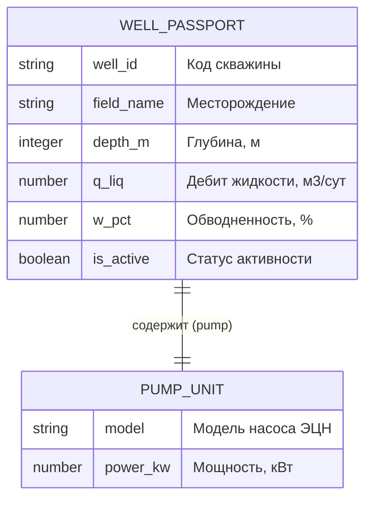

# Практическая работа № 2. Проектирование структур данных: JSON и JSON-Schema

Дисциплина: Программирование и прототипирование ИТ-решений
Вариант А: цифровой паспорт нефтяной скважины и погружного насоса

Студент 1: _______________
Студент 2: _______________

## Расчёт индивидуальных чисел

N = N1 + N2 = 15 + 6 = 21

| Параметр | Формула | Значение |
|---|---|---|
| well_id | `W-{100 + N}` | "W-121" |
| depth_m | `1500 + 50 * (N % 40)` | 2550 |
| q_liq | `45.0 + 3.5 * (N % 30)` | 118.5 |
| w_pct | `12.0 + 2.0 * (N % 35)` | 54.0 |
| power_kw | `40.0 + 5.0 * (N % 20)` | 45.0 |

## 1. Структура данных

| Поле (ключ) | Описание | Тип Python | Тип JSON | Обяз.? | Значение |
|---|---|---|---|---|---|
| well_id | Идентификатор (код) скважины | str | string | Да | "W-121" |
| field_name | Название месторождения | str | string | Да | "Приобское" |
| depth_m | Глубина скважины, м | int | integer | Да | 2550 |
| q_liq | Дебит жидкости, м³/сут | float | number | Да | 118.5 |
| w_pct | Обводнённость продукции, % | float | number | Да | 54.0 |
| is_active | Признак работы скважины | bool | boolean | Да | True (в JSON: true) |
| pump | Вложенный объект: погружной насос | dict | object | Да | {...} |
| pump.model | Модель насоса ЭЦН | str | string | Да | "ЭЦН5-80-1800" |
| pump.power_kw | Мощность насоса, кВт | float | number | Да | 45.0 |

В `data.json` ключи записаны в двойных кавычках, а `True` из Python превратилось в `true`.

## 2. Контракт данных

Правила лежат в файле `schema.json`. Валидатор `validator.py` читает их оттуда и проверяет `data.json`.

### Таблица сверки

| Тестовый сценарий | Ожидание | Фактический ответ | Совпало? |
|---|---|---|---|
| Сценарий 1: эталонный файл data.json | VALID (0 ошибок) | УСПЕШНО (VALID) | Да |
| Сценарий 2: выход за границы (depth_m = -100, w_pct = 145) | ОТКЛОНЕНО (2 ошибки) | Глубина depth_m=-100 вне границ схемы [500; 4500]; Поле 'w_pct'=145.0 вне границ схемы [0.0; 100.0] | Да |
| Сценарий 3: потеря обязательного поля well_id | ОТКЛОНЕНО (1 ошибка) | Отсутствует обязательное поле 'well_id' | Да |
| Сценарий 4: текст вместо числа в pump.power_kw | ОТКЛОНЕНО (1 ошибка) | Поле 'pump.power_kw' должно быть числом (number) | Да |
| Сценарий 5: broken_data.json | ОТКЛОНЕНО (2 ошибки) | Глубина depth_m=9000 вне границ схемы [500; 4500]; Во вложенном блоке 'pump' отсутствует поле 'model' | Да |

## Файлы

- `entity_model.py` — формирует паспорт, сохраняет в `data.json`, читает обратно
- `data.json` — паспорт скважины W-121
- `schema.json` — контракт данных (JSON-Schema)
- `validator.py` — проверка данных по схеме
- `broken_data.json` — файл с двумя нарушениями для сценария 5
